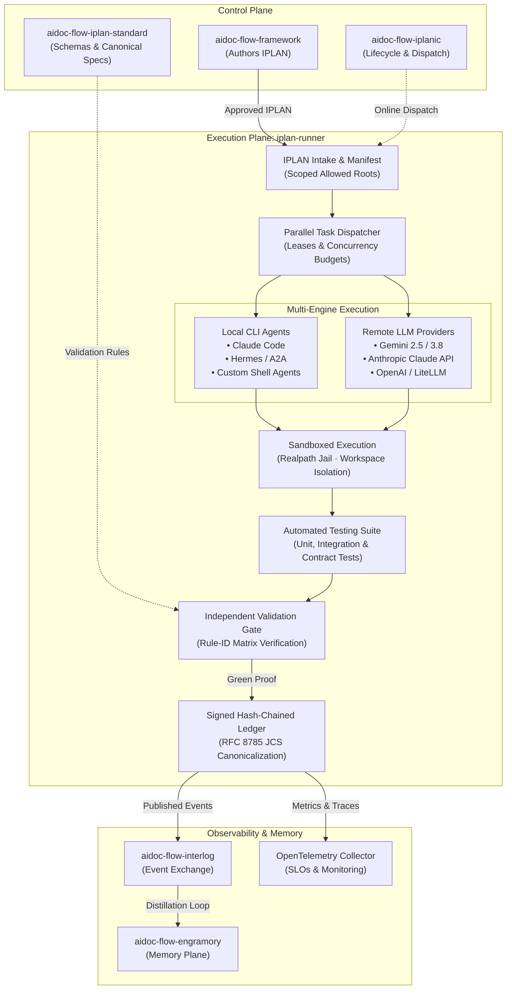

# Architectural Alignment: IPLAN Runner as the Multi-Engine Execution Platform

**Status:** Approved · **Date:** 2026-10-04  
**Scope:** Universal architectural alignment and execution topology for `iplan-runner` across the AIDOC Flow ecosystem.

---

## 1. Executive Summary

`iplan-runner` serves as the **operational execution engine** of the AIDOC Flow ecosystem. While `aidoc-flow-framework` (SDD) authors intent and requirements into approved implementation plans (`IPLAN-NN`), and `aidoc-flow-iplanic` acts as the distributed control plane, **`iplan-runner` physically executes the work**, transforming intent into verified, auditable code.

To support the full continuum of autonomous software development, `iplan-runner` is designed as a **multi-engine execution platform** capable of dispatching tasks to both **local interactive CLI coding agents** and **stateless remote LLM API providers**.

---

## 2. Core Architectural Pillars

### 2.1 Dual Execution Models: CLI Agents & Remote LLM APIs
`iplan-runner` decouples task definition from physical execution:
1. **Local CLI Coding Agents:**
   - Dispatches tasks to resident CLI agents (e.g. `claude`, `hermes`, `codex`) running inside bounded terminal contexts.
   - Suitable for exploratory implementations, multi-file refactorings, and interactive tool use.
2. **Direct Remote LLM API Providers:**
   - Dispatches structured prompts directly to remote model APIs (Gemini, Claude, OpenAI) via vendor SDKs or unified gateways (LiteLLM).
   - Ideal for deterministic code transformations, unit test generation, and automated validation scans.

### 2.2 Parallel Task Execution & Isolation
- **DAG Task Graphs:** Resolves dependency order across flat or chained task manifests.
- **Lease Protocol:** Prevents resource contention and race conditions when multiple workers operate simultaneously across separate workspace files (`framework/execution/` lease protocol).
- **Concurrency & Resource Budgets:** Enforces token limits, runtime duration ceilings, and process budgets per task.
- **Saga Compensation:** Provides deterministic rollback and compensation actions if a branch of a parallel task graph fails.

### 2.3 Sandboxed Execution & Deployment
- **Filesystem Jail:** Sandboxed effectors strictly enforce lexical and `realpath` boundary checks against `isolation_scope.allowed_roots`.
- **Zero Cross-Workspace Contamination:** Workers cannot access or modify sibling repositories or files outside the declared workspace.
- **Safe Command Execution:** Shell commands run in isolated subshells with environment scrubbing and secret redaction (`verify_ledger` / `redact`).

### 2.4 Automated Testing & Verification Loop
- Before declaring task completion, `iplan-runner` mandates the execution of local verification suites:
  - Unit tests (`pytest`, `unittest`).
  - Static linters and typechecks (`ruff`, `mypy`).
  - Security scans (credential detectors, SAST).
- Completion claims are rejected if test suites report non-zero exit codes.

### 2.5 Dual-Gate Validation & Confirmation
- **Deterministic Rule-ID Evaluation:** Independent validators evaluate completion against fine-grained rule IDs cataloged in `framework/conformance/rule-ids.yaml`.
- **Validation Report:** Produces a cryptographically bound `iplan-validation-report` validating that:
  - All manifest files were created or modified according to specification.
  - Required tests and gates passed.
  - The ledger remains unbroken.
- **Git Commit Landing:** Only green, validated runs are committed and landed onto integration branches.

### 2.6 Cryptographic Ledger & Ecosystem Observability
- **Immutable Ledger:** Every task state transition, command execution, and evidence artifact is appended to a hash-chained ledger signed via RFC 8785 JCS canonical JSON (`iplan_canonical`).
- **Interlog Integration:** Curated experience events are emitted to [`aidoc-flow-interlog`](file:///mnt/e/dev/aidoc-flow-interlog) to contribute to cross-project learnings.
- **Memory Distillation:** Lessons learned during execution are consumed by [`aidoc-flow-engramory`](file:///mnt/e/dev/aidoc-flow-engramory) to refine future plan authoring.
- **OpenTelemetry Monitoring:** Runtime probes export execution SLOs, durations, and failure topologies to OTel collectors.

---

## 3. Cross-Repository Contract Summary

| Companion Repository | Plane | Contract & Interaction |
|---|---|---|
| [`aidoc-flow-framework`](file:///mnt/e/dev/aidoc-framework) | Control Plane (Authoring) | Produces approved `IPLAN-NN` specifications (`EXEC-Ready ≥ 90`). |
| [`aidoc-flow-iplan-standard`](file:///mnt/e/dev/aidoc-flow-iplan-standard) | Standard / Normative Canon | Owns JSON Schemas (`task`, `execution-event`, `validation-report`) and canonical RFC 8785 reference implementation. |
| [`aidoc-flow-interlog`](file:///mnt/e/dev/aidoc-flow-interlog) | Logging & Interchange | Ingests published experience events from execution runs. |
| [`aidoc-flow-engramory`](file:///mnt/e/dev/aidoc-flow-engramory) | Memory & Knowledge | Subscribes to distilled lessons to inform subsequent planning cycles. |
| [`operations-assistant`](file:///mnt/e/dev/operations-assistant) | Orchestration & Roster | Central PM/PO orchestrator monitoring repository health and issue pipelines. |
